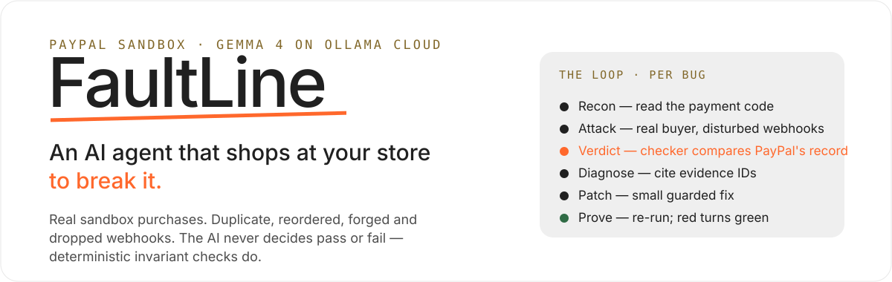
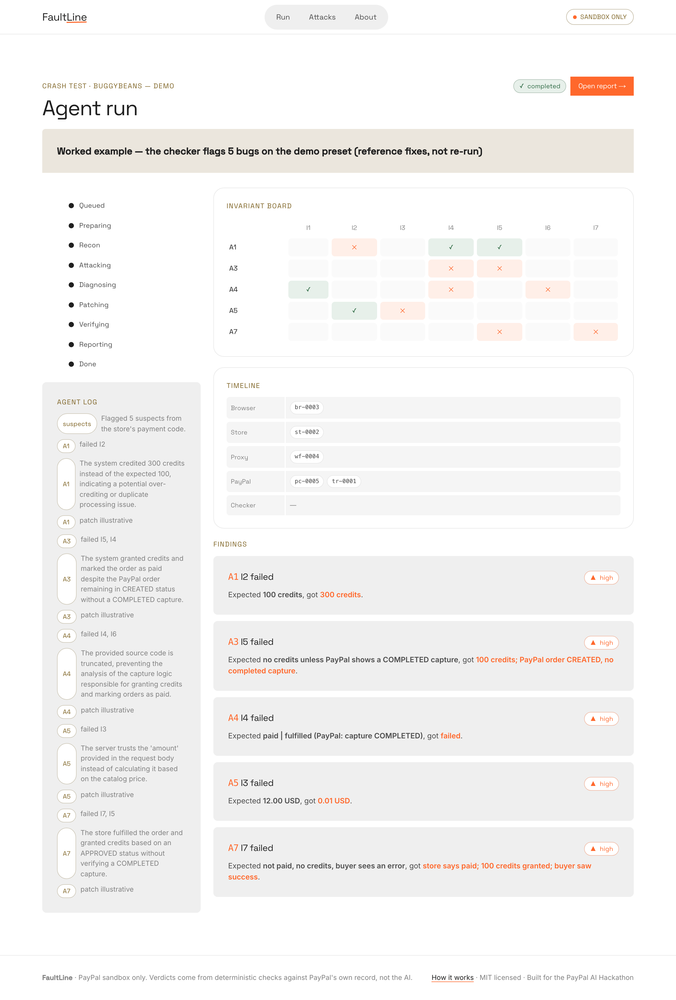
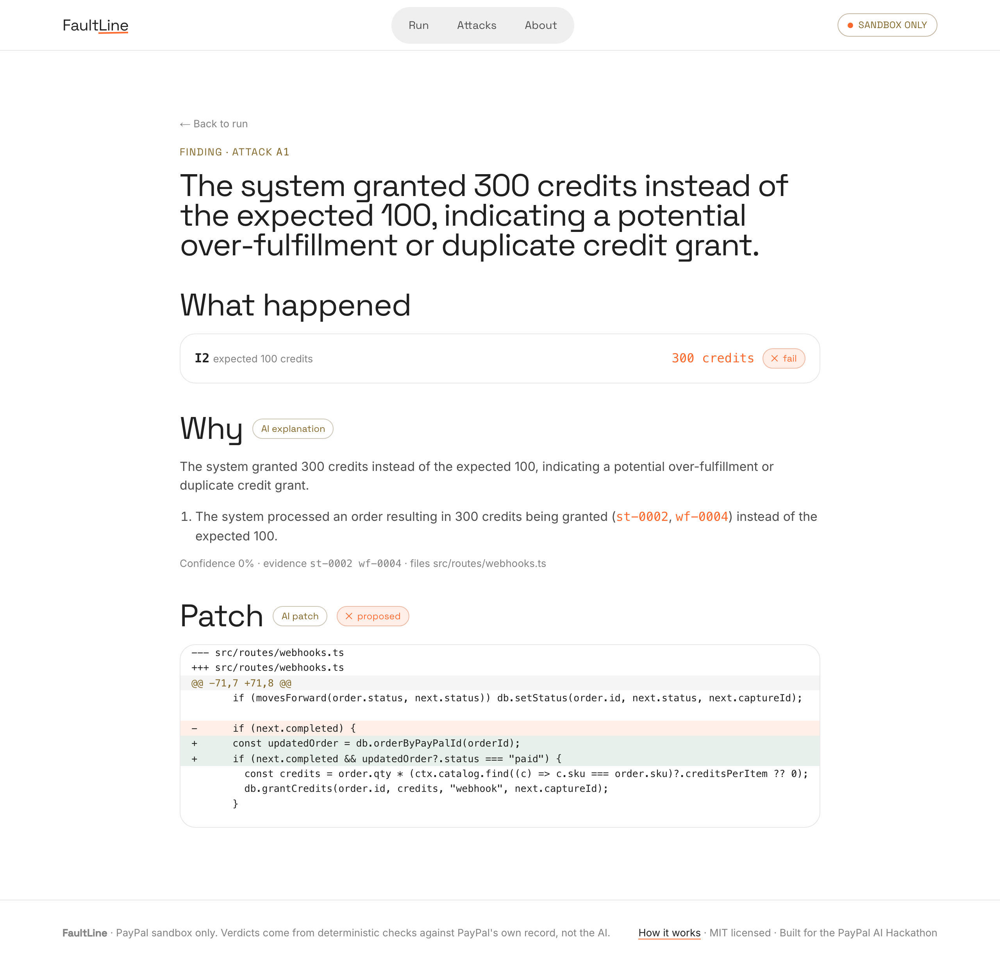

<p align="center">
  
</p>

<p align="center">
  <b>Sandbox only</b> · PayPal Orders v2 + webhooks · Gemma 4 31B on Ollama Cloud · <a href="LICENSE">MIT</a>
</p>

---

Most PayPal integrations are only tested on the happy path: one sandbox purchase that succeeds. But in production, webhooks arrive **twice** or **out of order**, a capture **times out after the money already moved**, a browser sends a **tampered price**, a payment is **declined**. Those are the paths that leak money and goods.

**FaultLine** is an AI agent that places *real* PayPal sandbox orders against a store, recreates those unhappy paths, and checks what the store did against PayPal's own record. The AI chooses attacks, explains failures and writes patches — but it **never decides pass or fail**. That verdict comes from deterministic invariant checks, so a finding can be trusted.

## See it

A finished crash-test report — five bugs found on the demo store, each with the AI's explanation, a fix diff, and a before/after proof from the checker:


<table>
<tr>
<td width="50%"><br><em>Live run — the invariant board and evidence timeline</em></td>
<td width="50%"><br><em>One finding — cause, patch, and proof</em></td>
</tr>
</table>

## Why it's different

- **The AI is never the judge.** Pass/fail are pure functions (`I1…I7`) over PayPal's order and capture records and the store's state probe. The model cannot mark a check passed, and cannot cite an evidence ID that isn't in the trace.
- **Real traffic, honestly labelled.** Every purchase, capture and webhook signature is real sandbox traffic. Forged events and injected faults are labelled as such, everywhere — in the trace, the UI and the report.
- **It proves the fix.** When the agent writes a patch, the *same* attack re-runs on a throwaway patched store under the *same* checks. Red turns green, or the patch is rejected.

## How it works

```
 web (Next.js)  ──►  api (FastAPI)  ◄──  worker / engine
                         │                    │
                     Postgres          proxy ─┴─ BuggyBeans (throwaway victim stores)
                                         │
                                   PayPal sandbox  ·  Ollama Cloud
```

The **worker** drives the loop; the **proxy** sits between PayPal and the store to replay, reorder, delay, withhold (and, via operator-supplied hooks, forge/fault) deliveries; **BuggyBeans** is the deliberately-buggy victim store spun up fresh per attack; the **checker** in `packages/core` is the only thing that decides a verdict.

### The attacks

| ID | Attack | Checks | What's real vs simulated |
|----|--------|--------|--------------------------|
| A1 | Duplicate webhook | I2, I4, I5 | Real signed delivery, replayed byte-for-byte |
| A2 | Out-of-order events | I4, I6 | Real deliveries, only their order changes |
| A3 | Forged webhook | I5, I4 | Real order; event forged and labelled forged |
| A4 | Capture times out after success | I1, I4, I6 | Real capture; the timeout is injected |
| A5 | Price tampering | I3, I2 | Real purchase; only the browser body is tampered |
| A6 | Fulfil without capture | I5, I4 | Real approved order; browser skips capture |
| A7 | Declined capture | I7, I5 | PayPal returns the decline itself |
| A8 | Dropped webhooks | I6, I4 | Real deliveries, withheld from the store |

## Run it

```bash
pnpm install                       # Node 24+ (native TS, no build step), pnpm
cp .env.example .env               # fill PayPal sandbox + Ollama keys (never commit this)

createdb faultline                 # or point DATABASE_URL at Postgres / Supabase
pnpm db:migrate
pnpm seed                          # the BuggyBeans targets
pnpm seed:demo                     # a worked-example report to browse

# API (FastAPI) — in apps/api
python3 -m venv .venv && . .venv/bin/activate && pip install -e ".[dev]" && python run.py
# web — in another shell
pnpm --filter web dev              # http://localhost:3000
```

Tests: `pnpm test` (TypeScript packages) and `pnpm test:api` (FastAPI).

## Safety

FaultLine is **sandbox only** and enforces it: the sole PayPal host it will reach is `api-m.sandbox.paypal.com`, checked at boot and in CI. It attacks only the bundled victim store (hosted mode), never applies patches to your real repository, and runs AI-written patches only in throwaway instances behind a guard (allowlisted files, no shell, no new hosts). The two behaviours that forge a signature (A3) or withhold a live capture response (A4) are operator-supplied hooks, run against your own sandbox account — they default to a safe no-op so those attacks are *skipped*, never faked.

> The worked-example report in the screenshots is labelled as such: its fixes are reference fixes shown for illustration and are not re-run. Live runs produce measured verdicts.

## License

[MIT](LICENSE). Built for the PayPal AI Hackathon. Verdicts come from deterministic checks against PayPal's own record, not the AI.
