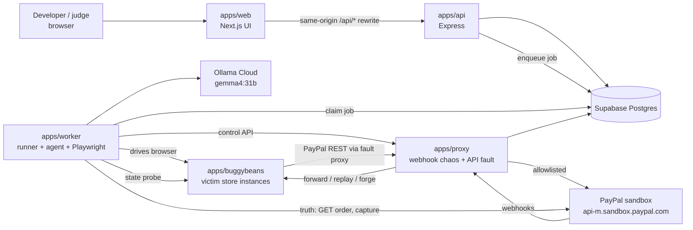
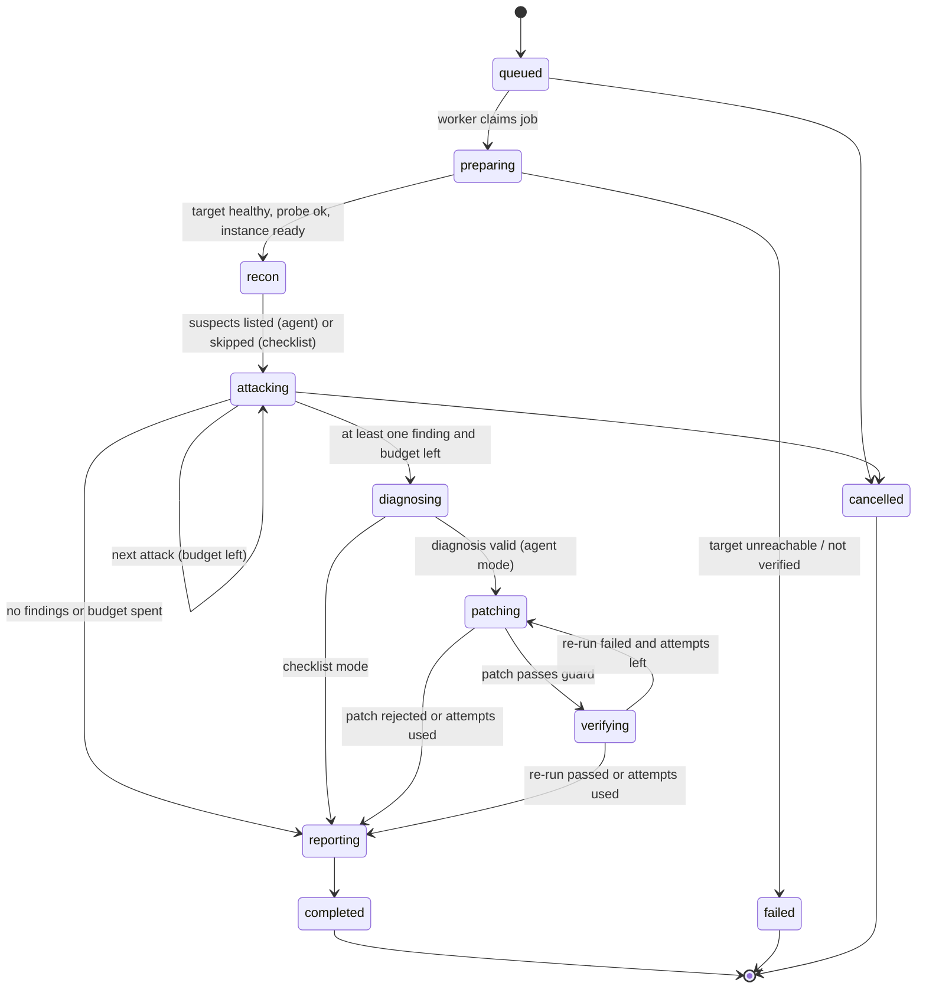
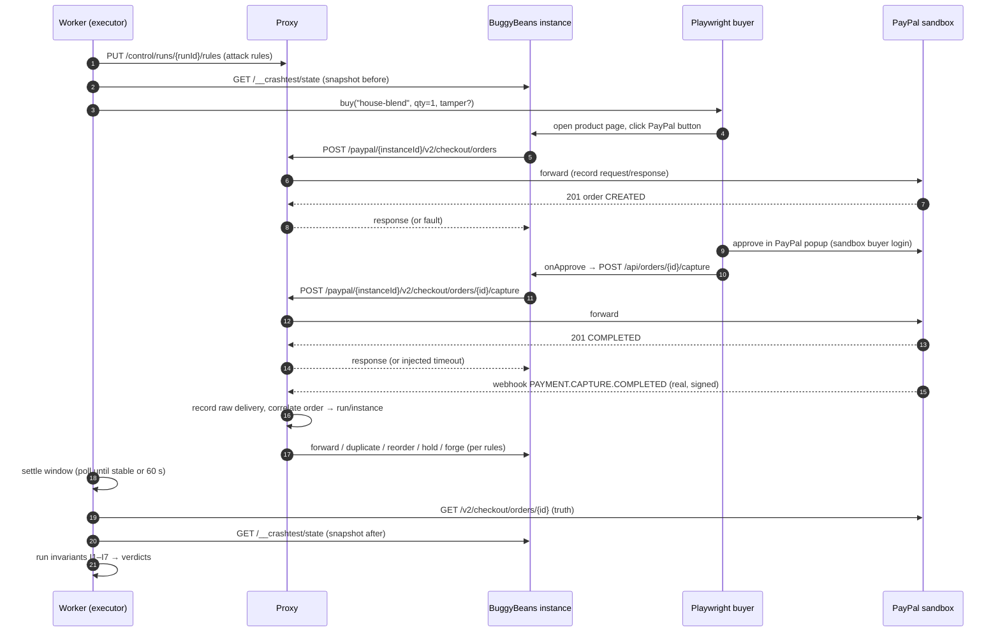
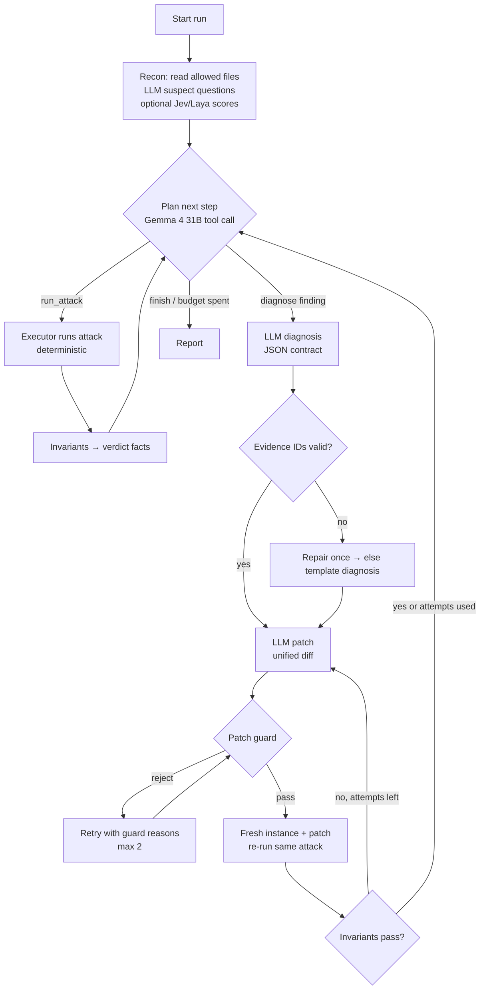

# 02. Architecture

Status: v1, written 2026-10-19 (IST). Stack: Turborepo, Next.js (UI), Express 5 (services), Supabase Postgres, Ollama Cloud (Gemma 4 31B), Playwright, PayPal sandbox.

## 1. Context

The buyer's browser session (Playwright) also talks to PayPal's hosted approval pages directly; that traffic is recorded by Playwright, not proxied.

## 2. Principles

1. **Truth comes from PayPal and the state probe, never from the model.** Invariants are pure functions over recorded facts.
2. **Every attack is a recorded experiment.** Inputs, PayPal calls, webhook deliveries, browser steps and state snapshots are stored, so any verdict can be replayed and audited.
3. **Real over simulated.** Real sandbox purchases and real webhook deliveries are the default. Simulator events and fixtures are labelled.
4. **AI is optional at runtime.** Checklist mode runs every attack without a model. Agent mode adds planning, diagnosis and patching. If Ollama is down, the run degrades to checklist mode and says so.
5. **Sandbox-only by construction.** One allowlist module (`@faultline/paypal/allowlist`) is the only way to build a PayPal URL. The proxy refuses any other upstream.
6. **Throwaway victims.** Every verification re-run gets a fresh BuggyBeans instance with its own SQLite file and port.
7. **The browser holds no secrets and talks to one origin.** `apps/web` calls `/api/*`, which Next.js rewrites to `apps/api`. Cookies stay first-party.
8. **Small, typed contracts.** zod schemas in `@faultline/schemas` are shared by every app.

## 3. Components

| Component | Path | Responsibility | Talks to |
| --- | --- | --- | --- |
| Web UI | `apps/web` | Pages: home, targets, new run, live run, finding, report, attack catalog. No route handlers, no DB | `apps/api` via `/api/*` |
| API | `apps/api` | Sessions (access code), targets, runs, findings, reports, SSE run stream, enqueue jobs | Postgres |
| Worker | `apps/worker` | Claims jobs; runs the run state machine; agent loop; attack executor; Playwright buyer; invariant checks; instance manager for BuggyBeans; patch apply + verify | Postgres, Ollama, PayPal (read truth), proxy control API, BuggyBeans |
| Proxy | `apps/proxy` (deployed inside the engine, §12) | **Instance gateway:** serves BuggyBeans instances publicly under `/i/<instanceId>/`. **Webhook chaos proxy:** ingress for PayPal webhooks, record raw delivery, correlate to run, forward / hold / replay / reorder / forge. **API fault proxy:** forwards a target's PayPal REST calls to the sandbox, records them, injects faults per run rules | PayPal sandbox, BuggyBeans, Postgres |
| Victim store | `apps/buggybeans` | Coffee shop with loyalty credits. PayPal JS SDK buttons, server-side create/capture, webhook handler, seeded bugs B1–B8 switched by env, state probe | PayPal (via proxy), its own SQLite |
| CLI (Should) | `apps/cli` | `faultline run`, `faultline report`, `faultline eval` against local or hosted API | `apps/api` |
| Shared | `packages/*` | schemas, core (attacks, invariants), agent, paypal, db, trace, patch, classifier, config | — |

## 4. Run lifecycle

Each transition writes a `run_events` row and pushes an SSE message. A run that loses its worker (crash) is reclaimed after `JOB_LEASE_SECONDS` (default 120) and resumes from the last completed attack.

## 5. Attack execution (one attack)

## 6. Webhook routing and correlation

- The sandbox REST app used by BuggyBeans has **one** webhook URL: `https://<proxy>/hooks/paypal`. Its webhook ID is `PAYPAL_WEBHOOK_ID`.
- On every delivery the proxy:
  1. Reads the raw body (bytes) and the five `PAYPAL-*` transmission headers; stores them in `webhook_deliveries` with `received_at`.
  2. Answers PayPal `200` immediately (fast ack; PayPal must not retry because of us).
  3. Extracts the resource's order ID (`resource.id` for `CHECKOUT.ORDER.*`; `resource.supplementary_data.related_ids.order_id` for `PAYMENT.CAPTURE.*` ⚠️ field path confirmed in S2).
  4. Looks up `paypal_calls` to find which instance created that order → `run_id`, `instance_id`, `instance_url`.
  5. Applies the run's webhook rules (pass-through, duplicate ×N, delay, hold-then-release in a chosen order, drop) and forwards **the exact bytes and headers** to `instance_url/webhooks/paypal`.
  6. Uncorrelated deliveries (no matching order) are stored and not forwarded.
- **Forged deliveries** (A3) are synthesised by the proxy from a template with a fresh order ID that PayPal never created and invalid signature headers. They are flagged `forged=true`.

## 7. API fault proxy

- BuggyBeans reads `PAYPAL_API_BASE`. FaultLine starts each instance with `PAYPAL_API_BASE=https://<proxy>/paypal/<instanceId>`.
- The proxy strips the prefix, validates the upstream path against an allowlist of Orders v2 and OAuth paths, forwards to `https://api-m.sandbox.paypal.com`, records request and response (with `Authorization` and token bodies redacted), and returns the response.
- Fault rules per run (set by the worker through the control API):
  - `timeout_after_forward`: forward, wait for PayPal's response, record it, then return `504` (or hang for `ms`) to the store. The money moved; the store thinks it failed.
  - `error_before_forward`: return a synthetic `503` without calling PayPal (labelled synthetic).
  - `negative_test`: add `PayPal-Mock-Response: {"mock_application_codes":"<CODE>"}` to the upstream request so PayPal itself returns the error ✅.
  - `latency`: add `ms` before forwarding.
- Rules match on method + path pattern + nth occurrence (e.g. "first capture call only").

## 8. Agent loop (agent mode)

Details, prompts, tool schemas and budgets: `docs/06-agent-spec.md`.

## 9. Instance manager (BuggyBeans)

- Hosted and local modes start BuggyBeans instances as **child processes** of the worker: `node apps/buggybeans/dist/server.js` with env `PORT`, `BUGS`, `SQLITE_PATH`, `PAYPAL_API_BASE`, `PROBE_TOKEN`, `INSTANCE_ID`, `PUBLIC_URL`.
- The hosted demo also runs one long-lived **public** BuggyBeans service (buggy preset) so judges can browse the store; attacks use worker-managed instances.
- Patched instances: the worker copies `apps/buggybeans/src` to a temp dir, applies the diff, type-checks with `tsc --noEmit` (time-boxed), builds with `tsup`, and starts it. Max 2 live patched instances per worker.
- Instances need a **public URL** for the buyer's browser and for webhook forwarding. They listen on `127.0.0.1:<port>` only; the proxy serves them publicly under `https://<proxy>/i/<instanceId>/` (a reverse-proxy route in `apps/proxy`). That is why the proxy and the worker run **in the same process/container** in hosted mode (the "engine", §12). Local: one tunnel (cloudflared or ngrok) points at the engine.
- BuggyBeans builds absolute URLs from `PUBLIC_URL=https://<proxy>/i/<instanceId>` so links and redirects work behind the prefix.

## 10. Jobs

- Table `jobs` (Postgres). Worker claims with `SELECT … FOR UPDATE SKIP LOCKED` and a lease. Requires the Supabase **session pooler (5432) or direct connection**, never the transaction pooler (6543) ✅ (2026-10-17).
- Job kinds: `run` (whole run), `eval` (batch of runs), `cleanup` (stop idle instances, purge old traces).
- One worker processes one run at a time (Ollama free tier allows 1 concurrent request ✅ 2026-10-17; Playwright is memory-heavy).

## 11. Live updates

- `GET /api/runs/:id/stream` is Server-Sent Events from `apps/api`, fed by `LISTEN run_events_<runId>` on Postgres (`pg` notification from the worker after each insert). Fallback: 2-second polling of `GET /api/runs/:id/events?after=`.
- No Supabase Realtime dependency (keeps one data path).

## 12. Deployment

`apps/proxy` and `apps/worker` are separate apps in the repo (separate tests, separate entry points), but hosted mode runs them **together** as one service, the **engine** (`apps/worker/src/engine.ts` starts the proxy's Express app and the worker loop in one process). One container then owns the public proxy URL, the Playwright browser and the child BuggyBeans instances, with no private networking needed.

| Service | Render type | Plan (judgement) | Notes |
| --- | --- | --- | --- |
| `faultline-web` | Web service (Next.js) | free → paid for judging | Or Vercel; Render keeps one vendor for the Render prize |
| `faultline-api` | Web service | free → paid for judging | |
| `faultline-engine` | Web service (proxy + worker + instances) | `1c-2g` ✅ plan exists | Public URL registered as the sandbox webhook. Must not sleep. Chromium needs > 512 MB ⚠️ (S7) |
| `buggybeans-public` | Web service | free | browseable demo store (buggy preset), not used for attacks |
| Database | Supabase | free | session pooler URL; project pauses after 7 quiet days ✅ (2026-10-17) |

Render free web services sleep after 15 minutes idle ✅ (2026-10-17) and offer 512 MB RAM ✅ (compute plans page, 2026-10-19). The engine cannot sleep, because PayPal webhooks would be lost; budget a paid instance from the hackathon's Render credits ⚠️ ($50 figure from the 2026-10-17 reading; re-check).

Local mode can run everything with `pnpm dev` (engine + api + web + Postgres via `docker compose` or a Supabase project) and one tunnel to the engine.

## 13. Decisions (ADRs)

| ID | Decision | Alternatives | Why | Revisit if |
| --- | --- | --- | --- | --- |
| ADR-001 | Web app + backend worker, not a browser extension | Chrome extension | Attacks are server-side (webhooks, capture faults); verdicts need backend state; judges need one click | Client-only bugs become the focus |
| ADR-002 | Express 5 for all services | Fastify, Next route handlers | Owner's choice; mature middleware; supertest | — |
| ADR-003 | `apps/proxy` is its own app but is deployed together with the worker as the "engine" | Proxy inside API; proxy and worker as separate services | Webhook ingress isolated from the product API; one container can serve instance URLs without private networking | Load requires scaling the worker separately |
| ADR-004 | Record and replay **real** webhook deliveries | Simulator events | Simulator events cannot be verified by postback ✅ | PayPal adds verifiable test events |
| ADR-005 | Truth = PayPal GET order/capture + state probe | Trusting store UI or model | Deterministic, auditable | — |
| ADR-006 | BuggyBeans on SQLite per instance | Supabase schema per instance | Fresh, isolated, instant; mirrors a typical small store | Need cross-instance analytics |
| ADR-007 | FaultLine data on Supabase Postgres via Drizzle + `pg`, no supabase-js in the browser | Supabase client SDK + RLS policies | One server-side data path; secrets never in the browser | Multi-tenant accounts are added |
| ADR-008 | Ollama Cloud, Gemma 4 31B, native `/api/chat` | OpenAI-compatible `/v1` endpoint, other providers | Owner's choice; native API verified earlier ✅ | S6 shows tool calls unreliable → JSON-action protocol (already supported) |
| ADR-009 | Model output always parsed + zod-validated + evidence-checked; template fallback | Trust structured output | Structured output support unclear ❓ | — |
| ADR-010 | Checklist mode with no AI | Agent-only | Baseline for evals and graceful degradation | — |
| ADR-011 | AI patches applied only to throwaway BuggyBeans copies, guarded | Apply to user repos / open PRs | Safety; scope | Post-hackathon GitHub App |
| ADR-012 | Hosted mode only attacks FaultLine-started BuggyBeans instances | Open targets | Abuse prevention | Ownership verification is hardened |
| ADR-013 | Postgres job queue with SKIP LOCKED | Redis/BullMQ, Render Workflows | No extra infra | Throughput needs |
| ADR-014 | SSE via Postgres LISTEN/NOTIFY | Supabase Realtime, websockets | Simple, one data path | Many concurrent viewers |
| ADR-015 | Next.js same-origin `/api/*` rewrite; httpOnly cookie session | CORS + cross-site cookies | Avoids the SameSite cookie gap found in the previous project | — |
| ADR-016 | Jev/Laya optional behind `CLASSIFIER_PROVIDER` | Required | New models, unclear access/cost after 31 Oct ✅ | They prove reliable and cheap |

## 14. Open questions (settled by spikes in `docs/18`)

1. Can Playwright complete the PayPal sandbox popup approval reliably? (S1)
2. Exact capture-event field path to the order ID. (S2)
3. Does a replayed real delivery pass `verify-webhook-signature` again? (S3)
4. Does Orders v2 capture honour `PayPal-Request-Id`; what does a second capture of the same order return? (S4)
5. Which `mock_application_codes` work on capture in our sandbox app (e.g. `INSTRUMENT_DECLINED` ⚠️)? (S5)
6. Exact Ollama Cloud model ID, tool-call reliability, `format` support, latency and limits for Gemma 4 31B. (S6)
7. Chromium memory on Render. (S7)
8. Can the engine container start, build and serve a patched BuggyBeans instance within the time budget? (S9)
